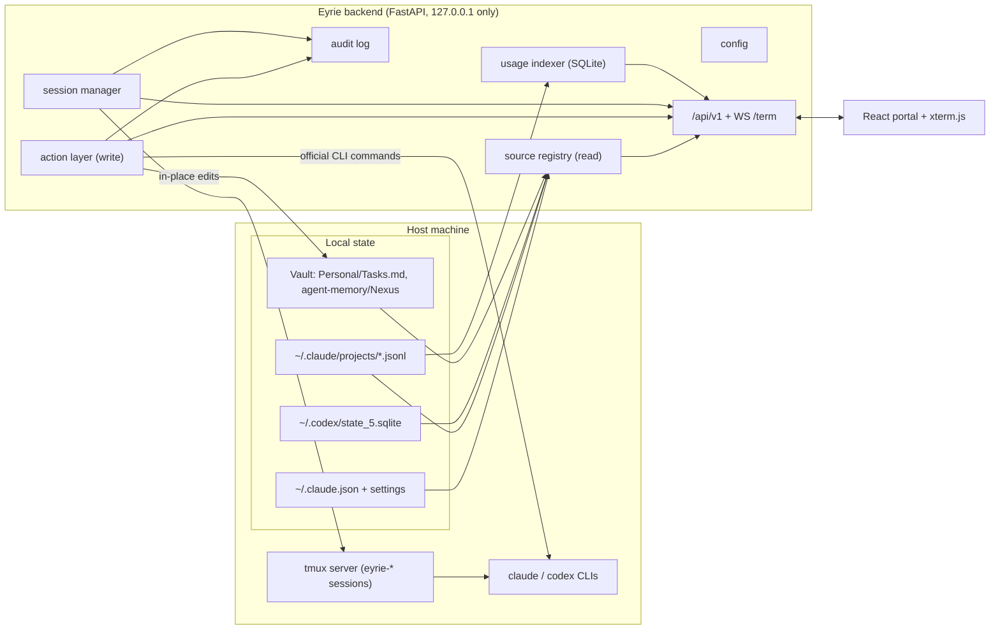

# Eyrie — revamp architecture (draft)

Status: **draft, under review**. This PR is design only. The prototype and the code
come in separate PRs once this is agreed.

## 1. Context

Eyrie v0 is a **read-only** dashboard: a FastAPI app reads local agent state on every
request, and a React portal polls it. The revamp turns it into a **control plane**:
everything about the local AI tooling (sessions, MCP servers, plugins, agent memory,
personal tasks) should be manageable from Eyrie, with full usage history.

v0 was built page by page, and these problems carry into the revamp:

| # | Problem | Where |
|---|---------|-------|
| P1 | Every source is a one-off module with its own path constants, error handling and return shape. Adding a source means touching the router, `types.ts`, `client.ts` and a new page | `backend/app/services/*.py`, `routers/status.py` |
| P2 | Paths are hardcoded to this machine (`~/workspace/Obsidian Vault/...`) | `services/tasks.py:6`, `services/nexus.py:6` |
| P3 | Claude cost only counts the **last session** per project (`lastCost`), so long-term spend is invisible | `services/claude.py:29` |
| P4 | Tasks writes rebuild the whole file: any non-task lines are dropped, and index-based IDs race with edits made in Obsidian | `services/tasks.py:21`, `routers/tasks.py:24` |
| P5 | The MCP status scan re-reads the 15 newest transcripts on every 10s poll | `services/mcp.py:17` |
| P6 | Frontend response types are written by hand, so they can drift from the backend | `frontend/src/api/types.ts` |
| P7 | Personal tool, but it shows whatever is in `~/.claude.json`, including work MCP server names | `services/claude.py:67` |
| P8 | Tasks point at the vault-root `Tasks.md`, which holds **work** tasks. Eyrie should only touch personal tasks | `services/tasks.py:6` |

## 2. Decisions so far

| Question | Decision |
|----------|----------|
| Read-only or control? | **Full control.** Everything manageable from Eyrie |
| Usage history? | **Yes, full history** from session transcripts |
| Tasks home? | **Vault, personal only**: `Personal/Tasks.md` (created on first write). The vault-root work `Tasks.md` is never read or written |
| Company tools? | **None.** Personal project, so no Qure-hosted integrations |

## 3. Goals / non-goals

**Goals**
- **Manage, not just view.** Each section has actions:
  - Sessions: start, resume, attach, stop.
  - MCP servers: add, remove, inspect.
  - Plugins: install, enable, disable.
  - Nexus memory: browse, edit, delete.
  - Tasks: full CRUD.
- **Full usage history**: cost and tokens over time, per model and per project.
- A uniform **source + action** abstraction: adding a capability means one backend module plus one page.
- Configurable paths, so it runs on another machine without code edits.
- Safe by default: localhost-only, authenticated actions, every action audit-logged.
- Keep the v0 principle: **local-only, no accounts, no cloud**.

**Non-goals**
- Multi-user and remote hosting.
- Any company/Qure integration.
- Replacing the Claude Code / Codex UIs. Eyrie orchestrates them and doesn't reimplement them.

## 4. Architecture



Two halves:
- **Read path**: the source registry reads state from disk.
- **Write path**: the action layer and session manager change things, and only through official interfaces.

### 4.1 Source contract (read, fixes P1)

```python
class Source(Protocol):
    id: str
    title: str
    def available(self) -> Availability: ...    # present? readable? why not?
    def snapshot(self) -> BaseModel: ...        # typed payload
```

- `GET /api/v1/sources` lists sources and their availability. `GET /api/v1/sources/{id}` returns a snapshot.
- Failures go through one shared envelope (`{available: false, reason}`).
- Parse results are cached, keyed by the inputs' `(path, mtime, size)`, so a poll costs a `stat()` (fixes P5).

### 4.2 Action layer (write)

**Rule: never hand-edit another tool's config files.** Changes go through that tool's own CLI, so Eyrie stays correct when those formats change:

| Capability | Mechanism |
|------------|-----------|
| MCP servers (Claude) | `claude mcp add / add-json / remove / get / list` |
| MCP servers (Codex) | `codex mcp ...` |
| Plugins | `claude plugin install / enable / disable / list` |
| Codex threads | `codex resume`, `codex exec` (via the session manager) |
| Nexus memory | Direct file ops inside `agent-memory/Nexus` only (Eyrie-owned scope) |
| Personal tasks | In-place line edits on `Personal/Tasks.md` (§4.5) |

- Actions are declared per source: `POST /api/v1/sources/{id}/actions/{action}`.
- Arguments are validated with pydantic. CLI calls use an **argv list** (`subprocess.run([...], shell=False)`) and never build shell strings.
- Destructive actions (remove an MCP server, delete a memory file, stop a session) need a confirm step in the UI and return a preview first.
- Every action writes an audit record (`~/.eyrie/audit.jsonl`): who, what, args, exit code, stderr.

### 4.3 Session manager

Claude Code and Codex are interactive TUIs, so Eyrie runs them inside **tmux**. tmux 3.6 is already installed.

- **Start**: `tmux new-session -d -s eyrie-<id> -c <repo> claude [--resume <sid>]`, or `codex` / `codex resume`.
- **Attach in the browser**: a WebSocket bridges a tmux client pty to **xterm.js** in the portal.
- **Attach from a terminal**: `tmux attach -t eyrie-<id>`. It's the same session, so the browser and terminal stay interchangeable.
- **Survives restarts**: sessions keep running if Eyrie restarts or crashes. On boot, Eyrie rediscovers them with `tmux ls`.
- **Stop**: `tmux kill-session`, after a confirm step.
- **Headless jobs** ("run this prompt in repo X"): `claude -p` / `codex exec` with output streamed to the UI.
- **Allowed repos**: sessions only start in directories from a config allowlist (`[sessions] roots`).

Why tmux rather than an in-process pty: sessions outlive Eyrie, you get free terminal attach, and there's no pty lifecycle code to maintain. The cost is a dependency on tmux, which is acceptable for a single-machine tool.

### 4.4 Usage history (fixes P3)

- Transcripts (`~/.claude/projects/*/*.jsonl`) carry per-message `usage` (input, output, cache read, cache creation). This was verified on the current Claude Code (2.1.x).
- An **incremental indexer** tracks `(file, byte offset)`, parses only appended lines, and writes per-message rows to `~/.eyrie/usage.db` (SQLite). It runs on start and then on file changes (`watchfiles`).
- The DB is a cache: deleting it triggers a full rebuild.
- **Cost** = tokens × a pricing table in config (transcripts don't store dollars), with "prices last updated" shown in the UI. `lastCost` from `~/.claude.json` is kept as a sanity check.
- **Codex**: `threads.tokens_used` + `updated_at` from its SQLite give per-thread and per-day history. It's read directly and not copied.
- **New Usage page**: daily and weekly cost and tokens, split by model and project, plus top sessions.

### 4.5 Personal tasks (fixes P4, P8)

- Default file: `<vault>/Personal/Tasks.md`, configurable. The vault-root `Tasks.md` (work) is out of scope.
- **Edit lines in place**: change only the target line and preserve every other line (headings, notes, blank lines).
- Task ID = hash of the line text plus its ordinal among duplicates.
- Writes carry the file's etag (mtime + size). If the file changed in Obsidian since the read, the write gets `409` and the UI refetches.
- Atomic writes (temp file + rename).

### 4.6 Config (fixes P2, P7)

`eyrie.toml` (gitignored, with a committed `eyrie.example.toml`), overridable with `EYRIE_*` env vars and loaded through `pydantic-settings`:

```toml
[paths]
claude_home = "~/.claude"
codex_home  = "~/.codex"
vault       = "~/workspace/Obsidian Vault"
tasks_file  = "Personal/Tasks.md"   # relative to vault

[sessions]
roots = ["~/personal/projects"]     # where sessions may be started

[privacy]
hide_mcp = []                       # server names hidden from the UI

[server]
port = 8000                         # always bound to 127.0.0.1
```

### 4.7 Security model

Control means Eyrie can run commands as you, so the threat to design against is **another web page or LAN device driving it**.

- **Bind address**: the backend binds to `127.0.0.1` only, never `0.0.0.0`.
- **Auth token**: a random token is generated on first run (`~/.eyrie/token`, mode 600) and is required on every mutating request and on the terminal WebSocket. The portal gets it through a one-time local bootstrap.
- **Host/Origin checks** block DNS rebinding and cross-site requests (only `localhost` / `127.0.0.1` are accepted).
- **Commands**: no arbitrary command endpoint. Only the declared actions in §4.2, with validated arguments.
- **Paths**: file actions are confined to their roots (resolve, then check the prefix) so `../` can't escape them.
- **Remote/phone access** is out of scope. If it's wanted later, it goes through Tailscale plus the same token, never a port open to the internet.

### 4.8 Deployment change

A container can't drive host tmux or the host's `claude`/`codex` with their credentials, so the revamp is **native-first**:
- `make dev` for development.
- `make install` adds a macOS `launchd` agent so Eyrie runs in the background.
- The Docker setup from v0 is dropped. If it's kept at all, it's a read-only "viewer" mode. Decide at the code phase.

### 4.9 API and types (fixes P6)

- `/api/v1` plus a WebSocket at `/api/v1/sessions/{id}/term`.
- TS types are generated from OpenAPI (`openapi-typescript`) with `make types`. CI fails if the file is stale.

### 4.10 Frontend

- Same stack: React + Vite + Tailwind v4 + shadcn/ui (Base UI) + react-router. xterm.js is added for terminals.
- The sidebar comes from `GET /api/v1/sources`.
- Pages:
  - Overview
  - **Sessions** (new): list, start, attach, stop
  - Claude Code
  - Codex
  - **Usage** (new)
  - MCP: with add and remove
  - Plugins: with enable and disable
  - Nexus: browse and edit memory
  - Tasks
- Destructive actions use a confirm dialog that shows exactly what will run.

## 5. Repo layout (target)

```
backend/app/
  config.py  security.py  audit.py
  sources/   base.py claude.py codex.py mcp.py plugins.py nexus.py tasks.py
  actions/   base.py runner.py          # argv-only subprocess wrapper
  sessions/  manager.py term_ws.py      # tmux + websocket bridge
  index/     usage.py                   # transcript indexer
  routers/   sources.py actions.py sessions.py usage.py
frontend/src/
  api/generated.ts
  pages/ ...  components/Terminal.tsx
docs/architecture.md
eyrie.example.toml
```

## 6. Tooling / MCPs used to build this

| Tool | Used for |
|------|----------|
| Obsidian MCP | Verify the vault layout (`Personal/`, `agent-memory/Nexus`) while building tasks and nexus |
| GitHub via `gh` | One PR per phase and per code slice |
| Artifact / `archify` | Clickable prototype and diagrams |
| Browser automation skill | Headless QA of every page before each merge |

At runtime, Eyrie makes no MCP calls. It manages MCP **config** through the official CLIs.

## 7. Delivery plan

Each step is its own PR, reviewed before the next one starts.

1. **Design**: this document.
2. **Prototype**: a clickable mock covering Sessions (with terminal), Usage, MCP add/remove, and Tasks with a conflict state.
3. **Code**, sliced:
   1. config, security (token, Host/Origin), source registry; existing sources ported
   2. personal tasks: in-place edits, etag
   3. usage indexer and Usage page
   4. action layer: MCP and plugins via the CLIs, audit log
   5. session manager: tmux, xterm.js, headless jobs
   6. Nexus memory management
   7. generated types, CI check, `launchd` install, README

## 8. Risks

| Risk | Mitigation |
|------|------------|
| Eyrie becomes a local command runner | §4.7: localhost only, token, Origin checks, declared actions only, audit log |
| CLI output formats change (`claude mcp list`, etc.) | Prefer JSON flags where they exist; parse defensively; integration test per CLI version |
| Transcript format is undocumented | Indexer ignores unknown fields, stores a schema version, falls back to `lastCost` |
| Pricing table goes stale | In config, with the date shown in the UI |
| First index build over a large history is slow | Background build with progress; incremental after that |
| A tmux session is orphaned after a crash | Rediscovered on boot via the `eyrie-` prefix; listed and killable from the UI |

## 9. Open questions

1. **Phone access**: wanted later (Tailscale), or strictly this laptop?
2. **Docker**: drop it, or keep a read-only viewer mode?
