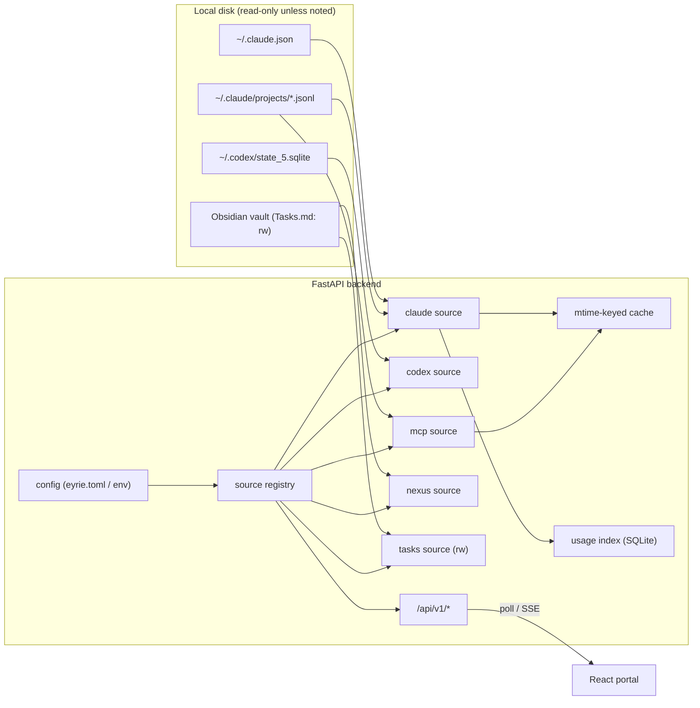

# Eyrie — revamp architecture (draft)

Status: **draft, under review**. This PR is design only. The prototype and the code
come in separate PRs once this is agreed.

## 1. Context

Eyrie v0 works: a FastAPI app reads local agent state on every request, and a React
portal polls it. It was built page by page, so each data source is wired in its own
way and some limits are now visible:

| # | Problem | Where |
|---|---------|-------|
| P1 | Every source is a one-off module with its own path constants, error handling and return shape. Adding a source means touching the router, `types.ts`, `client.ts` and a new page | `backend/app/services/*.py`, `routers/status.py` |
| P2 | Paths are hardcoded to this machine (`~/workspace/Obsidian Vault/...`) | `services/tasks.py:6`, `services/nexus.py:6` |
| P3 | Claude cost only counts the **last session** per project (`lastCost`), so long-term spend is invisible | `services/claude.py:29` |
| P4 | Tasks writes rebuild the whole file: any non-task lines are dropped, and index-based IDs race with edits made in Obsidian | `services/tasks.py:21`, `routers/tasks.py:24` |
| P5 | The MCP status scan re-reads the 15 newest transcripts on every 10s poll | `services/mcp.py:17` |
| P6 | Frontend response types are written by hand, so they can drift from the backend | `frontend/src/api/types.ts` |
| P7 | Personal tool, but it shows whatever is in `~/.claude.json`, including work MCP server names | `services/claude.py:67` |

## 2. Goals / non-goals

**Goals**
- A uniform **source** abstraction: adding a source means one backend module plus one page, nothing else.
- Configurable paths, so it runs on another machine without code edits.
- Real history: cost and token usage over time, not just a last-session snapshot.
- Safe tasks editing that never destroys the file's other content.
- Keep the v0 principle: **local-only, no accounts, no cloud**.

**Non-goals (for this revamp)**
- Multi-user, auth, remote hosting.
- Any company/Qure integration (gateway, Jira, Slack, Jenkins, Grafana…). Eyrie is personal.
- Launching or controlling agent sessions. This is an open decision, see §8.

## 3. Proposed architecture



### 3.1 Source contract (fixes P1)

Each source implements one small interface and registers itself:

```python
class Source(Protocol):
    id: str                     # "claude", "codex", ...
    title: str
    def available(self) -> Availability: ...    # present? readable? why not?
    def snapshot(self) -> BaseModel: ...        # typed (pydantic) payload
```

- The router is generic: `GET /api/v1/sources` lists sources and their availability, and `GET /api/v1/sources/{id}` returns the snapshot.
- Failures go through one shared envelope (`{available: false, reason}`) instead of each module inventing its own.
- Writable sources (tasks only, for now) add explicit action endpoints.

### 3.2 Config (fixes P2, P7)

`eyrie.toml` at the repo root (gitignored, with a committed `eyrie.example.toml`), overridable via `EYRIE_*` env vars, loaded with `pydantic-settings`:

```toml
[paths]
claude_home = "~/.claude"
codex_home  = "~/.codex"
vault       = "~/workspace/Obsidian Vault"
tasks_file  = "Tasks.md"          # relative to vault

[sources]
enabled = ["claude", "codex", "mcp", "nexus", "tasks"]

[privacy]
hide_mcp = []                     # server names to hide from the UI
```

Docker reuses the same config and maps the paths to mounts.

### 3.3 Usage history (fixes P3)

- Session transcripts (`~/.claude/projects/*/*.jsonl`) contain per-message token usage. Scanning them incrementally, keyed by file plus byte offset, gives full history.
- The results go into a small local SQLite index (`~/.eyrie/usage.db`). It's a cache only: deleting it triggers a rebuild.
- Cost = tokens × a **pricing table** kept in config, since transcripts don't store dollars. `lastCost` from `~/.claude.json` is kept as a cross-check.
- Codex is already in SQLite, so it's queried directly.

### 3.4 Tasks (fixes P4)

- Edit **lines in place**. Parse the file, change only the targeted line, and leave every other line untouched.
- Task ID = hash of the line text plus its ordinal among duplicates. A write is rejected (`409`) if the file changed since the client last read it (an mtime/etag check), so edits made in Obsidian at the same time don't get clobbered.
- Atomic writes (temp file + rename).

### 3.5 Caching and freshness (fixes P5)

- Each source caches its parse result keyed by the inputs' `(path, mtime, size)`. A poll costs a `stat()`, not a re-parse.
- Transport stays **polling** at first (simple, already works). Upgrade to SSE driven by `watchfiles` only if polling becomes noticeably wasteful. `watchfiles` already comes with uvicorn.

### 3.6 API and types (fixes P6)

- Version the API (`/api/v1`).
- Generate TS types from FastAPI's OpenAPI spec (`openapi-typescript`) via `make types`. CI fails if the generated file is stale.

### 3.7 Frontend

- Keep the current stack: React + Vite + Tailwind v4 + shadcn/ui on Base UI + react-router.
- Pages are driven by `GET /api/v1/sources`, so the sidebar lists only enabled and available sources.
- New: a **usage over time** page (daily cost/tokens per model and project) built on the index from §3.3.

## 4. Repo layout (target)

```
backend/app/
  config.py            # pydantic-settings
  sources/
    base.py            # Source protocol, Availability, registry
    claude.py codex.py mcp.py nexus.py tasks.py
  index/usage.py       # transcript scanner + SQLite index
  routers/sources.py routers/tasks.py
frontend/src/
  api/generated.ts     # from OpenAPI — do not edit
  pages/...            # one per source + Usage
docs/architecture.md
eyrie.example.toml
```

## 5. Tooling / MCPs used to build this

Personal tools only:

| Tool | Used for |
|------|----------|
| Obsidian MCP (configured) | Read and verify the vault layout (Tasks.md, `agent-memory/Nexus`) while building the tasks and nexus sources |
| GitHub via `gh` | PRs per phase. A GitHub MCP could be added later for PR/CI views inside Eyrie |
| Artifact / `archify` | Clickable prototype (phase 2) and diagrams |
| Browser automation skill | Headless QA of each page before merging |

Eyrie itself makes **no MCP calls at runtime**. It reads files on disk.

## 6. Delivery plan

Each phase is its own PR, reviewed before the next one starts.

1. **Design**: this document.
2. **Prototype**: a clickable HTML mock of the revamped portal (sidebar from the source registry, Usage page, tasks with conflict state). Feedback goes into this doc.
3. **Code**, sliced:
   1. config and source registry, existing sources ported (no behaviour change)
   2. safe tasks editing
   3. usage index and Usage page
   4. generated types, `make types` and CI check
   5. Docker/README refresh

## 7. Risks

| Risk | Mitigation |
|------|------------|
| Transcript format is undocumented and may change between Claude Code versions | Parser ignores unknown fields; the index stores a schema version; degrade to `lastCost` if parsing fails |
| Pricing table goes stale | Kept in config, with "last updated" shown in the UI |
| Large transcript history makes the first index build slow | Build incrementally in the background; the UI shows progress |

## 8. Open decisions (need answers before the prototype)

1. **Read-only vs control**: should Eyrie ever launch or resume Claude Code/Codex sessions? Saying yes changes the security model (it would be a local process runner).
2. **Usage history depth**: is full history from transcripts worth the complexity, or is "last-session plus daily snapshots taken by Eyrie" enough?
3. **Tasks home**: keep `Tasks.md` in the vault, or move to Eyrie's own store?
